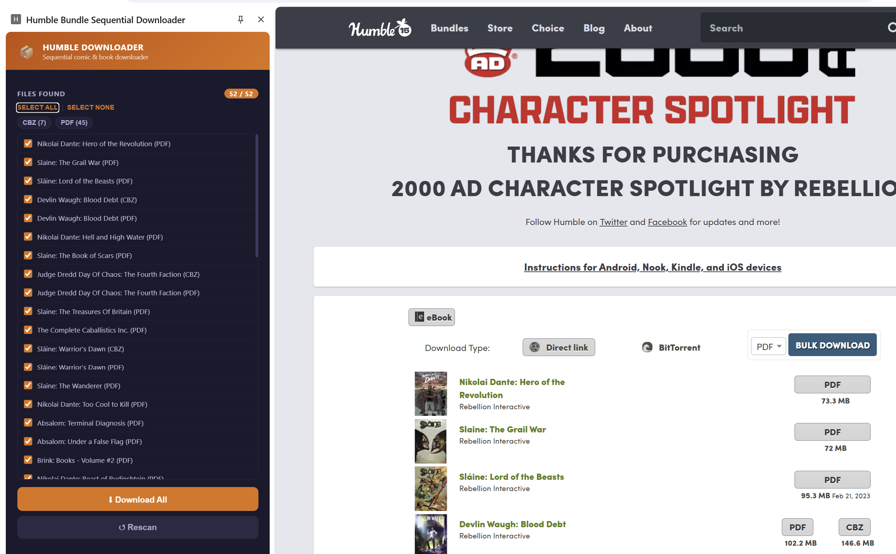
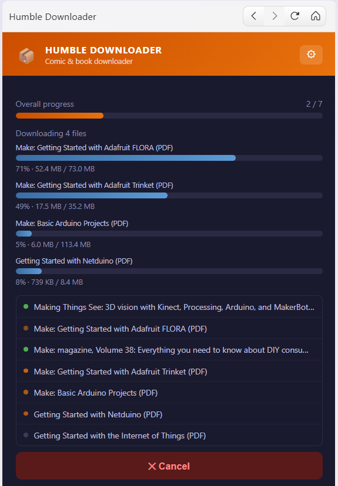

# Humble Bundle Downloader

A Chrome extension that downloads comics and books from your Humble Bundle library, with a configurable number of files downloading at the same time (1-8, default 4).

## Installation

0. Download the release and unzip it into a folder called `humble-bundle-downloader` somewhere safe
1. Open Chrome and go to `chrome://extensions`
2. Enable **Developer mode** (toggle in the top-right corner)
3. Click **Load unpacked**
4. Select the `humble-bundle-downloader` folder you created earlier

## Usage

0. I'd highly recommend in Chrome going into Settings, Downloads and turning off "Ask where to save each file before downloading" or you're going to get bored clicking
1. Open the bundle's page in your Humble Library  
   (e.g. `https://www.humblebundle.com/home/library/YOUR-BUNDLE-ID`) — each bundle in a purchase has its own library page
2. Click the extension icon in the Chrome toolbar — this opens the side panel, which stays docked to the browser window as you navigate
3. Click **Scan for Files** — it will find every downloadable file on the page (one entry per format: EPUB, PDF, MOBI, …)
4. Review the list, check or uncheck any titles you don't want, then click **Download Selected**
5. Files download in parallel — by default up to 4 at a time (see **Settings** below)

## Settings

Click the ⚙ gear in the side panel header to open the settings screen.

- **Simultaneous downloads** — how many files to download at the same time (1-8, default 4). Set it to 1 to go back to one-at-a-time. Changes apply immediately, even to a run that's already in progress.

## Notes

- Downloads go to your browser's downloads folder
- If a file already exists, Chrome will append a number to avoid overwriting
- Works with whatever formats Humble Bundle offers for a given title (PDF, EPUB, MOBI, CBZ, CBR, etc.) — the extension keeps each file's original format
- You can cancel mid-queue at any time
- When downloads run in parallel, files may finish out of order — the progress list reflects each file's actual state
- Works on both the classic download pages and the new library pages (`humblebundle.com/home/library/…`). The new pages don't expose file links, so the extension clicks each file's download button and captures the short-lived signed link the page generates, then downloads it itself
- The extension only activates on `humblebundle.com` pages
- The side panel persists across tab switches and page navigation within the window; it automatically updates based on whether or not you're on a Humble Bundle page

## Screenshots

### Pick which files to download

### Progress display

